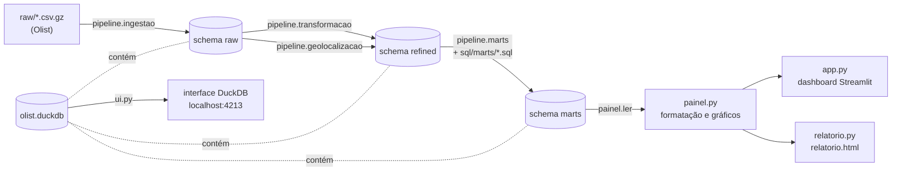

# empregadados-olist

Pipeline de dados e painel sobre o dataset público da **Olist**, um marketplace brasileiro de e-commerce com pedidos entre 2016 e 2018. O projeto lê os CSVs originais, limpa e tipa os dados num banco DuckDB local, calcula os indicadores da operação em tabelas de consumo (*marts*) e os apresenta em um dashboard Streamlit e em um relatório HTML offline.

> Written for: pessoas desenvolvedoras e analistas que vão rodar o projeto, entender como ele é organizado ou acrescentar um novo indicador.

## Sumário

- [Visão geral](#visão-geral)
- [Requisitos](#requisitos)
- [Instalação](#instalação)
- [Dados de entrada](#dados-de-entrada)
- [Como usar](#como-usar)
- [Capacidades](#capacidades)
- [Arquitetura](#arquitetura)
- [Estrutura de pastas](#estrutura-de-pastas)
- [Dependências](#dependências)
- [Testes](#testes)
- [Especificações](#especificações)

## Visão geral

O projeto segue desenvolvimento orientado a especificação: cada módulo tem sua spec na docstring do topo, com critérios de aceite, e os arquivos em `spec/` descrevem as decisões de cada etapa. Não há orquestrador: cada etapa é um script executável pela linha de comando, e as etapas são encadeadas à mão, na ordem indicada abaixo.

Principais decisões:

- **Banco local e único.** Todo o resultado fica no arquivo `olist.duckdb`, na raiz do projeto. Não há servidor de banco.
- **Três camadas no banco, mais uma de consumo:**
  - `raw`: o CSV como chegou, todas as colunas em texto, sem correção.
  - `refined`: colunas renomeadas para português, tipos corretos (datas, dinheiro em `DECIMAL`, CEP como texto) e duplicatas exatas removidas.
  - `marts`: as respostas de negócio, uma tabela por pergunta, escritas em SQL puro.
- **Regra de negócio no SQL.** Os marts são arquivos `.sql` em `sql/marts/`. O Python não calcula nada: apenas executa o arquivo e registra o resultado.
- **Nada que falhe em silêncio.** Conversão que não casa encerra o script com erro, em vez de virar nulo. Arquivo faltando interrompe a etapa antes de qualquer gravação.

## Requisitos

- Python **3.13** ou superior
- [uv](https://docs.astral.sh/uv/) para gerenciar o ambiente e as dependências
- Os nove arquivos `.csv.gz` da Olist na pasta `raw/` (ver [Dados de entrada](#dados-de-entrada))

## Instalação

```bash
# na raiz do projeto
uv sync
```

`uv sync` cria o `.venv` e instala as dependências travadas em `uv.lock`. Todos os comandos abaixo são executados com `uv run`, que usa esse ambiente.

## Dados de entrada

Os arquivos vêm do dataset público da Olist e devem estar em `raw/`, com estes nomes:

| Arquivo | Tabela no `raw` |
|---|---|
| `olist_orders_dataset.csv.gz` | `pedidos` |
| `olist_order_items_dataset.csv.gz` | `itens_pedido` |
| `olist_order_payments_dataset.csv.gz` | `pagamentos` |
| `olist_order_reviews_dataset.csv.gz` | `avaliacoes` |
| `olist_customers_dataset.csv.gz` | `clientes` |
| `olist_sellers_dataset.csv.gz` | `vendedores` |
| `olist_products_dataset.csv.gz` | `produtos` |
| `product_category_name_translation.csv.gz` | `traducao_categorias` |
| `olist_geolocation_dataset.csv.gz` | `geolocalizacao` |

A ingestão confere se os nove existem antes de gravar qualquer tabela. Os arquivos são lidos comprimidos, sem descompactar em disco.

## Como usar

### 1. Gerar o banco, na ordem

```bash
# 1. CSV -> schema raw (nove tabelas, tudo em texto)
uv run python -m pipeline.ingestao

# 2. raw -> schema refined (oito tabelas, tipadas e sem duplicatas exatas)
uv run python -m pipeline.transformacao

# 3. refined -> schema marts (doze tabelas de indicadores, a partir de sql/marts/)
uv run python -m pipeline.marts
```

Cada etapa é reexecutável: rodar duas vezes dá o mesmo resultado que rodar uma. A ingestão e a transformação recriam suas tabelas; a etapa de marts recria o schema inteiro, então um mart cujo `.sql` foi apagado desaparece na execução seguinte.

A etapa de geolocalização é separada, porque nenhum mart a usa:

```bash
uv run python -m pipeline.geolocalizacao   # raw.geolocalizacao -> refined.geolocalizacao
```

### 2. Ver os resultados

```bash
# Dashboard interativo (Streamlit), em http://localhost:8501
uv run streamlit run app.py

# Relatório HTML estático, um arquivo só: gera relatorio.html na raiz
uv run python relatorio.py
```

O dashboard lê o banco a cada carregamento e guarda o resultado em cache; o botão **Recarregar dados** força uma nova leitura. Se algum mart estiver faltando, a página diz quais e qual comando rodar.

### 3. Explorar o banco

```bash
# Interface do DuckDB no navegador, em http://localhost:4213
uv run python ui.py
```

Atenção: o DuckDB permite um único processo escrevendo no arquivo. Com `ui.py` aberto, as etapas do pipeline falham com `Could not set lock on file`. Encerre a interface com Ctrl+C antes de rodar o pipeline.

Em terminais Windows, use `uv run python -X utf8 ...` para que acentos e tabelas saiam corretamente.

### Resumo dos comandos

| Comando | O que faz |
|---|---|
| `uv sync` | Prepara o ambiente a partir do `uv.lock` |
| `uv run python -m pipeline.ingestao` | CSV → `raw` |
| `uv run python -m pipeline.transformacao` | `raw` → `refined` |
| `uv run python -m pipeline.geolocalizacao` | `raw.geolocalizacao` → `refined.geolocalizacao` |
| `uv run python -m pipeline.marts` | `refined` → `marts` |
| `uv run streamlit run app.py` | Abre o dashboard |
| `uv run python relatorio.py` | Gera `relatorio.html` |
| `uv run python ui.py` | Abre a interface de exploração do DuckDB |
| `uv run pytest --cov` | Roda os testes e mostra a cobertura |
| `uv run ruff check .` | Confere o estilo do código |

## Capacidades

### Pipeline

- Ingestão dos nove CSVs para o schema `raw`, com contagem por tabela e total conferido no banco.
- Transformação para o schema `refined`: renomeia 47 colunas para português, converte datas (`TIMESTAMP`/`DATE`), dinheiro (`DECIMAL(10,2)`) e medidas (`INTEGER`), e remove apenas duplicatas exatas. Chaves repetidas com conteúdo diferente interrompem a execução.
- Conversão que falha interrompe a execução mostrando tabela, coluna e o valor que não converteu. Nenhum nulo é criado pela conversão.
- Marts em SQL: cada arquivo `NN_nome.sql` vira `marts.nome`. Tudo roda numa única transação; se algum mart falhar ou ficar vazio, o schema `marts` volta ao estado da última execução bem-sucedida.

### Marts

| # | Mart | Pergunta que responde |
|---|---|---|
| 01 | `vendas_mensais` | Quanto vendemos por mês? |
| 02 | `top_categorias` | Quais categorias mais vendem? |
| 03 | `entrega_no_prazo` | Quanto chegou no prazo? |
| 04 | `nota_por_categoria` | Que nota cada categoria recebe, e qual a posição dela? |
| 05 | `recompra` | Quantos clientes voltaram a comprar? |
| 06 | `ticket_medio_por_estado` | Qual o ticket médio por estado? |
| 07 | `mix_pagamento` | Como os pagamentos se dividem entre tipos, nos pedidos válidos? |
| 08 | `nota_por_prazo` | Qual a nota de quem recebeu no prazo e de quem atrasou? |
| 09 | `vendedores_pareto` | Quanto da receita vem de poucos vendedores? |
| 10 | `tempo_entrega_por_estado` | Quanto tempo leva a entrega em cada estado? |
| 11 | `kpis` | Os cartões do dashboard que não saem dos marts 03 e 05 |
| 12 | `clientes_por_uf` | Quantas pessoas compram de cada UF? |

Cada mart tem a regra escrita em comentário no próprio `.sql`, incluindo o que conta como pedido válido (pedidos `canceled` e `unavailable` ficam fora da receita).

### Dashboard (`app.py`)

- Sete cartões de indicadores: ticket médio, cancelados, peso do frete, recompra, entregas no prazo, dias até entregar e nota média.
- Faturamento mensal com seletor de período (jan/2017 a ago/2018 por padrão).
- Seis gráficos: receita por categoria, mix de pagamento, ticket por UF, clientes por UF, nota por categoria e concentração de vendedores (curva de Pareto).

### Relatório (`relatorio.py`)

- Um único `relatorio.html`, com plotly embutido no primeiro gráfico, pronto para abrir offline e enviar por e-mail.
- Mesmos cartões, faixas e gráficos do dashboard, gerados pelas mesmas funções de `painel.py`.

## Arquitetura



### Camadas e responsabilidades

| Módulo | Papel |
|---|---|
| `pipeline/db.py` | Conexão com o `olist.duckdb` (caminho relativo ao próprio projeto), criação de schema e gravação de DataFrame. Não lê CSV nem conhece regra de negócio. |
| `pipeline/ingestao.py` | Lê os CSVs como texto e grava o `raw`. Não converte, não remove linha e não corrige valor. |
| `pipeline/transformacao.py` | Renomeia colunas, converte tipos em SQL, remove duplicatas exatas e grava o `refined`. Confere antes se o mapa de colunas bate com o `raw`. |
| `pipeline/geolocalizacao.py` | Mesma lógica da transformação, para a tabela de geolocalização. |
| `pipeline/marts.py` | Executa cada `sql/marts/NN_*.sql` numa transação e recria o schema `marts`. |
| `painel.py` | Lê os marts, formata números no padrão brasileiro e monta as figuras plotly. Não faz cálculo: só ordena, filtra e formata. |
| `app.py` | Monta a página Streamlit (layout, filtro de período, cache). Não importa dados de outro lugar. |
| `relatorio.py` | Gera o HTML estático reaproveitando `painel.py`. Não importa Streamlit. |
| `ui.py` | Sobe a interface de exploração do DuckDB. Fora da cobertura de testes. |

Princípios que atravessam o código:

- **Caminhos a partir do projeto**, nunca do diretório de execução: rodar um script de outra pasta não cria banco novo no lugar errado.
- **Sem cálculo fora do SQL.** Um indicador novo nasce como um `.sql` em `sql/marts/`; o painel só o exibe.
- **Dinheiro é `DECIMAL`, nunca `DOUBLE`**, e CEP é texto, porque tem zero à esquerda.
- **Falhas são explícitas.** `sys.exit(1)` com a mensagem de correção (ex.: "Rode `uv run python -m pipeline.ingestao` antes."), em vez de resultado parcial.

## Estrutura de pastas

```
.
├── pipeline/            # etapas do pipeline (ingestão, transformação, geolocalização, marts)
├── sql/marts/           # uma consulta SQL por indicador (NN_nome.sql)
├── test/                # testes unitários, com dados inventados em tmp_path
├── raw/                 # CSVs da Olist (não versionados)
├── spec/                # especificações de cada etapa, em português
├── docs/                # diagramas ER dos schemas raw e refined
├── design/              # rascunho visual do dashboard
├── painel.py            # leitura dos marts, formatação e gráficos
├── app.py               # dashboard Streamlit
├── relatorio.py         # relatório HTML estático
├── ui.py                # interface de exploração do DuckDB
├── olist.duckdb         # banco gerado pelo pipeline
└── pyproject.toml       # dependências e configuração de pytest/coverage
```

## Dependências

Declaradas em `pyproject.toml` e travadas em `uv.lock`.

**Execução**

| Pacote | Versão mínima | Uso |
|---|---|---|
| `duckdb` | 2.0.0 (fixa) | Banco de dados local e execução do SQL |
| `pandas` | 3.1.0 | Leitura dos CSVs na ingestão e DataFrames do painel |
| `plotly` | 7.1.0 | Gráficos (`plotly.express`) no dashboard e no relatório |
| `streamlit` | 1.66.1 | Dashboard (`app.py`) |

**Desenvolvimento**

| Pacote | Versão mínima | Uso |
|---|---|---|
| `pytest` | 9.2.0 | Testes |
| `pytest-cov` | 7.1.0 | Cobertura de código |
| `ruff` | 0.17.3 | Lint e estilo |

Python 3.13 é exigido pelo `pyproject.toml`. A extensão `ui` do DuckDB é instalada pelo próprio `ui.py` (`INSTALL ui`) na primeira execução.

## Testes

```bash
uv run pytest --cov
```

- 93 testes unitários em `test/`, um arquivo por módulo.
- Nenhum teste abre o `olist.duckdb` nem lê `raw/`. Cada teste cria seu próprio DuckDB e seus CSVs de exemplo em `tmp_path`, com poucas linhas cujo resultado esperado é calculado à mão.
- A meta é de 60% de cobertura de linhas no total de `pipeline/`, `painel.py` e `relatorio.py`. `app.py` e `ui.py` ficam de fora: o dashboard é conferido no navegador, não por cobertura.
- Os testes não verificam a qualidade do dado real (chaves únicas, totais que batem). Isso fica para uma etapa própria de validação.

## Especificações

As decisões do projeto estão em `spec/`, uma por etapa:

| Arquivo | Conteúdo |
|---|---|
| `spec/01_spec.md` | Visão geral e escopo do pipeline |
| `spec/02_transformacao.md` | Renomeações, tipos e regras de duplicata e nulo do `refined` |
| `spec/03_geolocalizacao.md` | Tratamento da tabela de geolocalização |
| `spec/04_marts.md` | Convenção de arquivos, execução transacional e erros dos marts |
| `spec/05_dashboard.md` | Layout e comportamento do dashboard |
| `spec/05_relatorio_html.md` | Formato do relatório HTML |
| `spec/07_testes_unitarios.md` | Regras dos testes unitários |

Os diagramas do schema estão em `docs/` (`er_raw.md`, `er_refined.md`, `diagrama_raw.md`).
