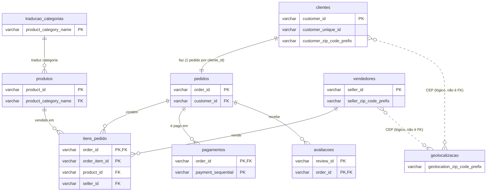

# Diagrama entidade-relacionamento: schema raw

Gerado a partir dos dados de `raw` (olist.duckdb). Só as colunas de chave aparecem.
Relacionamentos e cardinalidades foram verificados no banco, não só pelos nomes das colunas.

## Verificações que sustentam o diagrama

| Relação | Órfãos no filho | Pais sem filho | Máx. filhos por pai | Observação |
|---|---|---|---|---|
| pedidos → clientes (`customer_id`) | 0 | 0 | 1 | Cada `customer_id` tem um único pedido. `customer_unique_id` é quem identifica a pessoa. |
| itens_pedido → pedidos (`order_id`) | 0 | 775 | 21 | 775 pedidos sem itens |
| pagamentos → pedidos (`order_id`) | 0 | 1 | 29 | 1 pedido sem pagamento |
| avaliacoes → pedidos (`order_id`) | 0 | 768 | 3 | Um pedido pode ter mais de uma avaliação |
| itens_pedido → produtos (`product_id`) | 0 | 0 | 527 | Todo produto foi vendido |
| itens_pedido → vendedores (`seller_id`) | 0 | 0 | 2033 | Todo vendedor vendeu |
| produtos → traducao_categorias | 13 | 0 | 3029 | 13 produtos com categoria sem tradução. Os 610 produtos com categoria nula ficam de fora da conta. |
| clientes / vendedores → geolocalizacao (CEP) | 278 / 7 | — | — | Não é chave estrangeira: os prefixos de CEP não batem todos. Ligação só lógica. |

## Pontos de atenção

- **`avaliacoes` não tem chave única por `review_id`:** 98.410 valores distintos em 99.224 linhas. A chave que a spec define é `(avaliacao_id, pedido_id)`.
- **`itens_pedido` e `pagamentos` têm chave composta:** `(order_id, order_item_id)` e `(order_id, payment_sequential)`. Ambas são únicas no banco.
- **`geolocalizacao` não entra no modelo do curso** (a spec exclui essa tabela da transformação), mas o diagrama mostra a ligação lógica por CEP para não esconder que ela existe.
- **Não há chaves estrangeiras declaradas no `raw`.** O diagrama mostra as relações que os dados sustentam. O `raw` é só texto.
