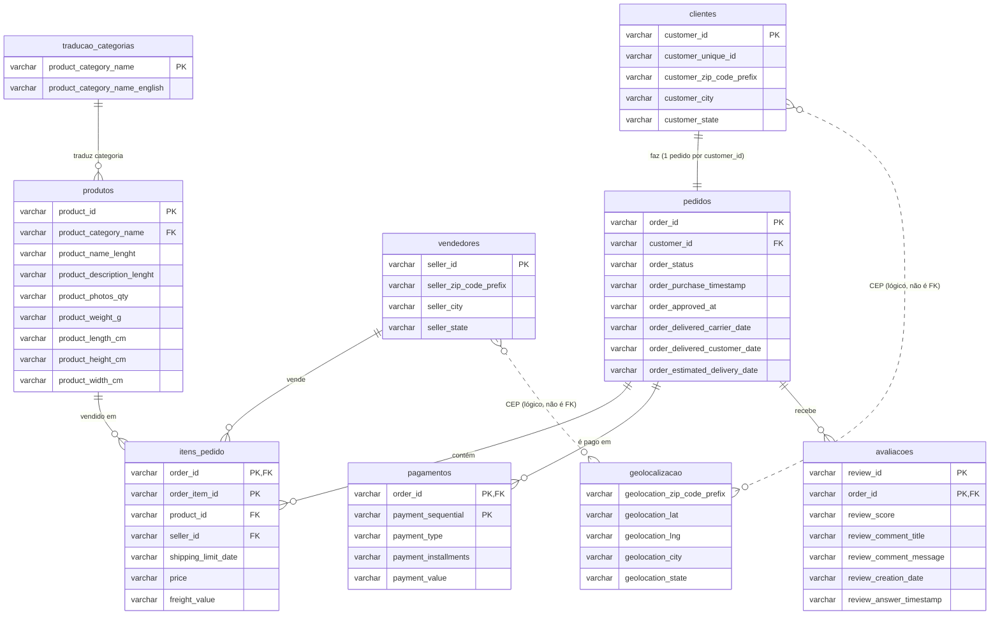

# Diagrama entidade-relacionamento: schema raw (colunas completas)

Schema `raw` do olist.duckdb: nove tabelas, todas as colunas em `VARCHAR`.
O `raw` não declara chaves. As marcações PK e FK abaixo vêm da verificação nos dados.

## Chaves e relações verificadas

| Relação | Órfãos no filho | Pais sem filho | Máx. filhos por pai |
|---|---|---|---|
| pedidos → clientes (`customer_id`) | 0 | 0 | 1 |
| itens_pedido → pedidos (`order_id`) | 0 | 775 | 21 |
| pagamentos → pedidos (`order_id`) | 0 | 1 | 29 |
| avaliacoes → pedidos (`order_id`) | 0 | 768 | 3 |
| itens_pedido → produtos (`product_id`) | 0 | 0 | 527 |
| itens_pedido → vendedores (`seller_id`) | 0 | 0 | 2033 |
| produtos → traducao_categorias | 13 | 0 | 3029 |
| clientes / vendedores → geolocalizacao (CEP) | 278 / 7 | — | — |

As chaves únicas confirmadas: `pedidos.order_id`, `clientes.customer_id`, `produtos.product_id`, `vendedores.seller_id`, `traducao_categorias.product_category_name`, `itens_pedido (order_id, order_item_id)`, `pagamentos (order_id, payment_sequential)`.

`avaliacoes.review_id` não é chave sozinho: 98.410 valores distintos em 99.224 linhas. A chave que a spec define é `(avaliacao_id, pedido_id)`.

Os CEPs de `clientes` e `vendedores` não batem todos com `geolocalizacao`, então essa ligação é lógica e não uma chave estrangeira.
