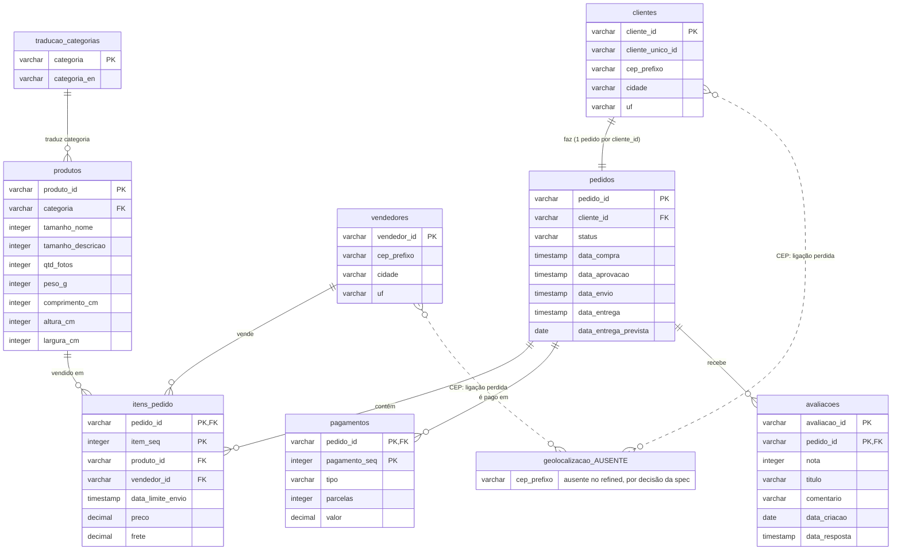

# Diagrama entidade-relacionamento: schema refined

Schema `refined` do olist.duckdb: oito tabelas, com colunas renomeadas para português e tipadas
conforme `spec/transformacao.md`. A tabela `geolocalizacao`, que existe no `raw`, está fora do
`refined` por decisão da spec (seção 1: nenhum mart do curso usa).

## Tabelas do raw que faltam no refined

| Tabela do raw | Status no refined | Motivo |
|---|---|---|
| `geolocalizacao` (1.000.163 linhas) | **Ausente** | Spec, seção 1: nenhum mart do curso usa. |

As outras oito tabelas do `raw` estão no `refined`, com o mesmo número de colunas e nomes em português.

## Consequência do que falta

Em `raw`, `clientes.cep_prefixo` e `vendedores.cep_prefixo` tinham ligação lógica com `geolocalizacao`, sem chave estrangeira. No `refined`, essa ligação não existe mais: não há como cruzar CEP com latitude e longitude. O diagrama mostra a ligação como perdida.

## Chaves e cardinalidades (verificadas no refined)

As chaves são as da spec, seção 5. Nenhuma tabela tem chave estrangeira declarada; as relações são as que os dados sustentam, as mesmas verificadas no `raw`.

- `pedidos (pedido_id)`, `clientes (cliente_id)`, `produtos (produto_id)`, `vendedores (vendedor_id)`, `traducao_categorias (categoria)`
- `itens_pedido (pedido_id, item_seq)`, `pagamentos (pedido_id, pagamento_seq)`, `avaliacoes (avaliacao_id, pedido_id)`

Tipos: `DECIMAL(10,2)` para `preco`, `frete` e `valor`; `INTEGER` para as contagens e medidas; `TIMESTAMP` para as cinco datas com hora em `pedidos` e as demais datas com hora; `DATE` para `data_entrega_prevista` e `data_criacao`; `cep_prefixo` continua `VARCHAR`.
